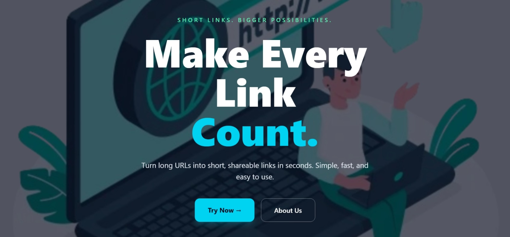
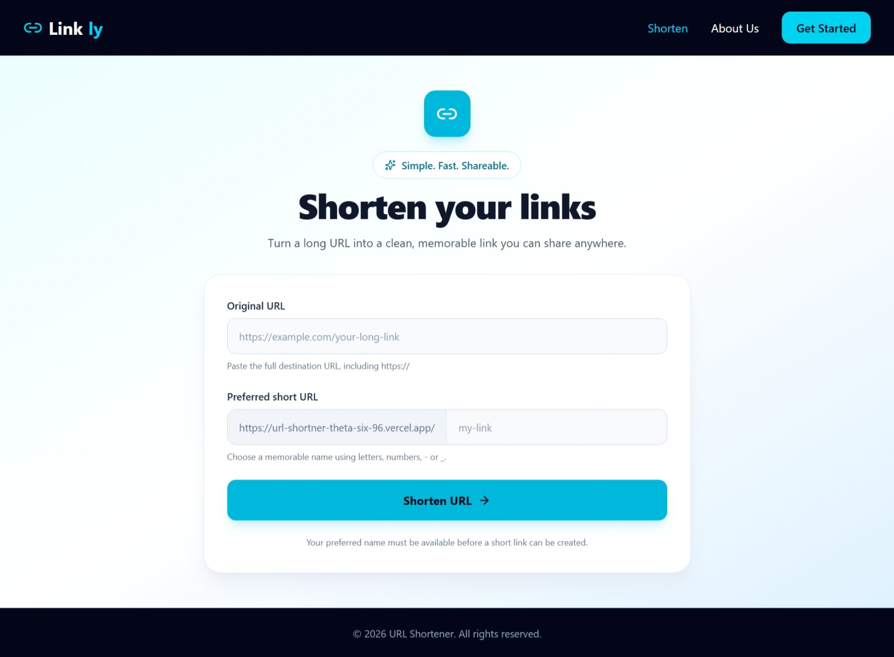
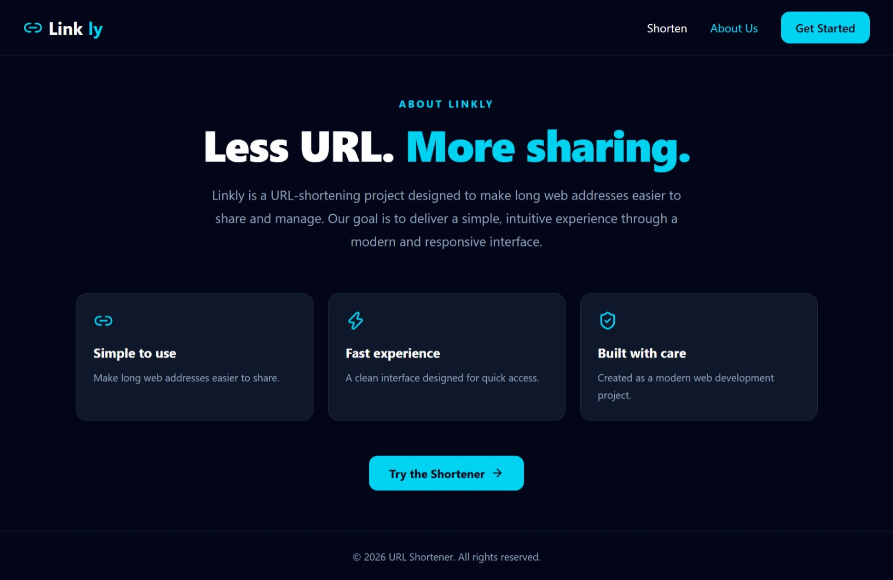

# Linkly — URL Shortener

Linkly is a URL shortener built with Next.js and MongoDB Atlas. It allows users to create short, memorable links using custom aliases and redirect visitors to the original URLs.

## Features

- Create short links with custom aliases.
- Store URL mappings in MongoDB Atlas.
- Redirect short links to their original destinations.
- Detect duplicate short aliases.
- Copy generated links easily.
- Responsive user interface for desktop and mobile.
- Active navigation link highlighting.

## Tech Stack

- **Framework:** Next.js (App Router)
- **Frontend:** React
- **Styling:** Tailwind CSS
- **Icons:** Lucide React
- **Database:** MongoDB Atlas
- **Database Driver:** MongoDB Node.js Driver
- **Deployment:** Vercel

## Live Demo

**Live Website:** [Linkly URL Shortener](https://url-shortner-theta-six-96.vercel.app/)

## Screenshots

### Landing Page



### Shorten URL Page



### About Page



## Getting Started

### 1. Clone the Repository

```bash
git clone YOUR_GITHUB_REPOSITORY_URL
cd url-shortner
```

Replace `YOUR_GITHUB_REPOSITORY_URL` with your GitHub repository's actual URL.

### 2. Install Dependencies

```bash
npm install
```

### 3. Configure Environment Variables

Create a `.env.local` file in the root directory:

```env
MONGODB_URI=your_mongodb_atlas_connection_string
```

Replace the example value with your MongoDB Atlas connection string. Never upload `.env.local` or expose your database credentials publicly.

### 4. Run the Development Server

```bash
npm run dev
```

Open [http://localhost:3000](http://localhost:3000) in your browser.

### 5. Build for Production

```bash
npm run build
npm run start
```

## How It Works

1. Enter an original URL and a preferred short alias.
2. The application validates the submitted information.
3. The API checks MongoDB for an existing alias.
4. If the alias is available, the URL mapping is saved to the database.
5. Visiting the generated short link redirects the visitor to the original URL.

## Deployment

This project is deployed using Vercel.

To deploy your own version:

1. Push your project to GitHub.
2. Import the repository into Vercel.
3. Select Next.js as the framework if it is not detected automatically.
4. Add `MONGODB_URI` under your Vercel project's environment variables.
5. Deploy the application.
6. Test URL creation and redirection on the deployed website.

If you change environment variables after deployment, redeploy the project for the changes to take effect.

## Future Improvements

- Click analytics for shortened URLs.
- Link expiration.
- QR code generation.
- A dashboard for managing created links.
- Additional URL validation and abuse prevention.

## Author

**Areej Fatima**

Built as a learning project to practice Next.js, API route handlers, MongoDB integration, and deployment.